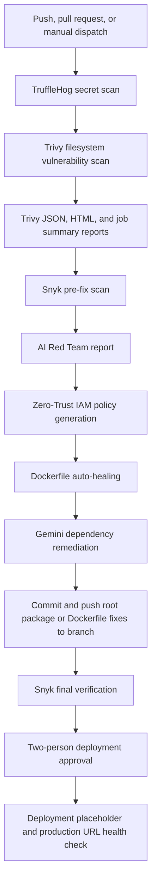

# AI Remediator DevSecOps CI/CD Pipeline

[](https://github.com/)
[](https://github.com/)
[](https://ai.google.dev/)
[](LICENSE)

This repository contains an AI-powered application and a GitHub Actions DevSecOps pipeline. The workflow scans for exposed secrets and vulnerable dependencies, generates security reports, runs AI-assisted security analysis and remediation, verifies fixes, and gates the production job behind manual approvals.

## Pipeline overview

The workflow is defined in `.github/workflows/devsecops.yml`.



The workflow runs on pushes and pull requests to all branches, and can also be started with `workflow_dispatch`. Because the deployment job has no branch condition, it can run after successful verification on any branch, subject to its approval requirements.

## Workflow jobs

### 1. Security scans and Trivy reports

- **TruffleHog** scans the checked-out repository for secrets.
- **Trivy** scans the filesystem for vulnerabilities at `CRITICAL`, `HIGH`, `MEDIUM`, and `LOW` severity. The scan writes `trivy-results.json` and is configured not to fail the job based on findings.
- A Trivy report is added to the GitHub Actions job summary, and HTML and JSON reports are uploaded as artifacts.
- The workflow sends a pipeline-start notification to Telegram when `TELEGRAM_BOT_TOKEN` and `TELEGRAM_CHAT_ID` are configured. It trims line endings and an optional `bot` token prefix.

### 2. Snyk scan and AI remediation

- Snyk runs a pre-fix scan with a high-severity threshold and writes `snyk-results.json`. This initial scan is allowed to continue when it reports vulnerabilities.
- Three Gemini-powered scripts run as part of this job:
  - `scripts/ai_red_teamer.py` analyzes project source and generates `ai-red-team-report.md`.
  - `scripts/ai_zero_trust_policy.py` infers cloud service needs from `package.json` and generates `zero-trust-iam-policy.json`.
  - `scripts/ai_iac_healer.py` analyzes and may rewrite the repository `Dockerfile`.
- `scripts/ai_remediator.py` reads `snyk-results.json`, asks Gemini for package update commands for fixable findings, and executes returned `npm install` commands. It sends Telegram status messages when Telegram credentials are configured.
- The workflow stages the root `package.json`, `package-lock.json`, and `Dockerfile`, commits any resulting changes, and attempts to push them to the triggering branch. It does not stage nested package manifests.

### 3. Final verification

The workflow checks out the latest triggering branch and runs Snyk again with a high-severity threshold. This final scan must pass before the production job can proceed.

### 4. Production approval and health check

The deployment job uses the `production` GitHub Environment and also runs `trstringer/manual-approval@v1`. The action requests at least two approvals from:

- `BiradarSwapnilDeveloper`
- `vaseflamingoseguru205-debug`

Repository environment protection rules, including any configured reviewers or wait timer, are managed separately in GitHub Settings.

**Deployment limitation:** The workflow's "Deploying Application to Render" step currently prints status messages and sleeps for three seconds; it does not call a Render deploy hook or API. The following step checks `https://pixelcraft-ai-94y5.onrender.com/` and reports the HTTP status, but a failed status does not fail the job. Configure a real Render deployment trigger and stricter health-check behavior if the workflow should deploy and enforce production health.

## GitHub Actions secrets

Configure these under the repository's **Settings → Secrets and variables → Actions**:

| Secret | Used for |
| --- | --- |
| `GEMINI_API_KEY` | Red Team, Zero-Trust IAM, Dockerfile healing, and dependency remediation |
| `SNYK_TOKEN` | Snyk pre-fix and final verification scans |
| `TELEGRAM_BOT_TOKEN` | Optional Telegram pipeline and remediation notifications |
| `TELEGRAM_CHAT_ID` | Optional Telegram destination |

The workflow uses `GITHUB_TOKEN` for repository operations and for the manual approval action. The remediation job requests `contents: write` and `pull-requests: write`; the deployment job requests `issues: write`.

## Workflow artifacts

| Artifact | Contents | Retention |
| --- | --- | --- |
| `trivy-report-html` | Downloadable Trivy HTML report | GitHub default |
| `trivy-report-json` | Trivy JSON scan output | GitHub default |
| `ai-red-team-report` | AI Red Team and threat-modeling report | 7 days |
| `zero-trust-iam-policy` | Generated IAM policy JSON | 7 days |
| `ai-debug-log` | AI remediator debug log | 1 day |

Trivy also writes a report to the GitHub Actions job summary. The Snyk JSON file is consumed by the remediation script in its job and is not uploaded as an artifact.

## Repository structure

```text
.
├── .github/
│   └── workflows/
│       └── devsecops.yml
├── scripts/
│   ├── ai_iac_healer.py
│   ├── ai_red_teamer.py
│   ├── ai_remediator.py
│   └── ai_zero_trust_policy.py
├── Dockerfile
├── html.tpl
├── package.json
├── package-lock.json
└── README.md
```

## License

This project is licensed under the [MIT License](LICENSE).
